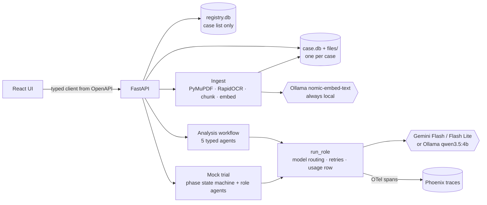

# Lawyer AI — design

A case-preparation assistant for a criminal defence (or prosecution) lawyer under Indian BNS/BNSS procedure. The lawyer uploads all material for **one case** (notes, PDFs, scanned statements, evidence photos). The system finds contradictions and weak evidence, prepares cited arguments, and runs a mock trial against AI role-players.

Status (2026-10-21): Stages 0–4 built and evaluated (ingest, search, analysis, arguments). Stage 5 (mock trial) is in progress; Stage 6 (case assistant chat) and Stage 7 (deploy) are planned. The staged plan is in [plan.md](plan.md); decisions are in [adr/](adr/).

---

## 1. Requirements

### Functional (5)

| # | Requirement | How it is met | Status |
|---|---|---|---|
| FR1 | **Ingest one case's files**: text, PDFs (text or scanned), photos of documents and evidence; search them. | PyMuPDF text blocks with page boxes; RapidOCR for scans/images; page-bound chunks; hybrid search (BM25 + embeddings, RRF); viewer highlights the exact region. | Built. OCR 0.99, retrieval recall@5 1.0 on samples |
| FR2 | **Find conflicting testimony** between witnesses, and between testimony and documents/physical evidence. | Extract atomic claims → name the case's factual questions → compare claims per question → typed conflicts with type, severity, helps/hurts. | Built. 11/13 planted contradictions found |
| FR3 | **Spot weak or missing evidence**, and what helps or hurts the client. | Each element of the charged offence + a procedural checklist marked supported / weak / missing, plus the evidence that hurts us. | Built. 9/10 planted gaps found |
| FR4 | **Prepare arguments** per issue: our argument, the other side's answer, our rebuttal, cross-examination questions, all cited to page/image. A case chat assistant answers questions with citations. | One argument call per issue (max 12). Citations verified in code. Assistant = the one tool-calling agent. | Arguments built; assistant planned (Stage 6) |
| FR5 | **Mock trial**: judge, public prosecutor / opposing counsel, investigating officer, witnesses; the lawyer argues against them, then gets a debrief. | Code state machine for phases (opening → examination-in-chief → cross → final arguments → judgment); role agents only speak, each with its own knowledge scope; objection check + judge ruling; debrief coach. | In progress (Stage 5) |

### Non-functional (5)

| # | Requirement | Target | How / measured |
|---|---|---|---|
| NFR1 | **Confidentiality and case isolation** | No path from one case's request to another case's content; confidential cases never leave the machine. | One SQLite file + folder per case; strict hex case ids (no path tricks); `local_only` cases forced onto Ollama; traces can drop content (`TRACE_CONTENT=false`). Tested: isolation tests, path-escape test. |
| NFR2 | **Groundedness** | Every finding cites a page/region; ≥ 95% of citations verified. | Agents cite `{chunk_id, quote}`; code checks the quote is in that chunk (≥ 0.9 fuzzy). Unverifiable claims are dropped; other citations get one corrective retry, then are shown as "unverified". Measured: **100% verified**. |
| NFR3 | **Low cost** | ≤ $0.10 per case analysis; local mode free. | Role-based routing (cheap model for high-volume roles), group-then-compare instead of pairwise comparison, capped issues. Measured: **$0.06 per case**. |
| NFR4 | **Latency** | Ingest ≈ 2 s/page on a laptop CPU; analysis < 6 min per case; trial turn < 5 s on cloud. | Measured: ingest 26–32 s for 15 pages; analysis 257–318 s. Trial latency to be measured in Stage 5. |
| NFR5 | **Observable, evaluable, portable** | Every LLM call traced and costed; quality measured against answer keys; runs locally first, then deploys; provider-agnostic. | OTel → Phoenix (one trace per analysis run); `llm_calls` row per call with trace id; eval suites with 2 synthetic cases; config-driven model routing (Gemini / Ollama / Anthropic / OpenAI). |

---

## 2. Estimation (back of the envelope)

### Workload assumption
A small chambers of **10 lawyers**. Per lawyer per working day: **2 case analyses** (one new case plus one re-run after adding documents), **1 mock-trial session** (~40 lawyer turns), **20 assistant questions**. A typical real case is **~300 pages**, about half of them scans.

### Compute

| Step | Measured on samples | Extrapolated to a 300-page case | Bound by |
|---|---|---|---|
| Ingest: text PDF page | < 0.1 s | — | CPU |
| Ingest: OCR of a scanned page/image | ~3–5 s (first call +10 s model warm-up) | 150 scans × 4 s ≈ **10 min** | CPU (laptop, no GPU) |
| Ingest: embeddings (local nomic) | 26–32 s per 15-page case incl. OCR | ~1,500 chunks ≈ **2–3 min** | CPU |
| Analysis workflow (cloud) | **257–318 s**, 32–36 LLM calls | ~80 documents → ~80 extraction calls (3 in parallel) + ≤ 20 aspects ≈ **8–12 min** | Provider rate limits (3 parallel calls) |
| Search query | milliseconds (numpy over one case) | 1,500 × 768 dot products ≈ 1 ms | — |
| Local model (qwen3.5:4b, CPU) | ~4 output tokens/s; 94–218 s for one extraction | 30+ min per analysis | CPU; fine only for short role-play |

Daily load for the chambers: **20 analyses** (~1.5 h of background work in total, in parallel per case), **10 trial sessions**, **200 questions**. This is easily handled by one server process.

### Storage

| Item | Size | Per 300-page case |
|---|---|---|
| Original uploads | scans ~100 KB/page | ~30 MB |
| Viewer page PNGs (110 dpi) | ~150 KB/page | ~45 MB |
| Chunks: text + 768-dim float32 embedding | ~4 KB/chunk, ~5 chunks/page | ~6 MB |
| Analysis results, usage rows, trial transcripts | small | < 1 MB |
| **Total** | | **≈ 80 MB per case** |

At ~200 active cases a year that is **~16 GB/year** on local disk. Phoenix traces are separate and can be pruned.

### Scale and limits
- **Fine for MVP:** brute-force cosine search inside one case (up to ~100k chunks); SQLite per case; one async FastAPI process.
- **First bottlenecks:** (1) provider rate limits and overloads (seen: Gemini 503, so we added SDK retry, Flash → Flash Lite fallback, and transport retry); (2) CPU OCR for large scanned bundles; (3) background jobs run in-process, so a restart loses them (a running job is treated as stale after 30 min).
- **Scale path (not built):** a job queue with worker processes (e.g. arq/RQ), hosted or GPU OCR, Postgres for the registry once there are multiple users and firms. Per-case SQLite stays; it is the isolation boundary.

---

## 3. Data

| Store | What it holds | Why this choice |
|---|---|---|
| `data/registry.db` (SQLite) | List of cases only: title, client, side, charges, `local_only`, embedding model. | No case content in a shared place. |
| `data/cases/<id>/case.db` (SQLite, one per case) | documents, pages, chunks + **FTS5** index + **embeddings as BLOBs**; claims, conflicts, elements, adverse evidence, issues; jobs; `llm_calls` (tokens, cost, latency, prompt version, trace id); trial sessions (Stage 5). | The case is a **hard isolation boundary** ([ADR-0001](adr/0001-case-isolation.md)): leaking needs code that opens two files. Zero infrastructure, backup = copy a folder, delete = delete a folder. Versioned schema (`PRAGMA user_version`), migrations serialised under a lock. |
| `data/cases/<id>/files/`, `pages/` | Original uploads; rendered page PNGs for the viewer. | Plain files; served only for known document ids of that case. |
| Phoenix (container) | OTel traces: every agent run, model request, tokens, latency, cost; optional prompt/response text. | Debugging and quality work. Its data is separate from case data; `TRACE_CONTENT=false` keeps confidential text out. |
| `samples/` (git) | Two synthetic cases, generated from `case.yaml`, with answer keys and scripted trial rounds. | Ground truth for evals; nothing real or confidential in git. |

**Not used:** a vector database (one case is small; numpy is enough), Postgres (no multi-user yet), Redis (no queue yet).

### Do we need RAG?

**Partly, and deliberately not for the core analysis.**

- **Analysis does not use retrieval.** The extractor reads **every document in full** (a case is tens of thousands of tokens, read one document at a time), and code decides which claims to compare. Contradiction-finding needs completeness: you cannot retrieve a contradiction you don't know to ask about. Retrieval would silently miss evidence, and full reading costs only ~$0.03 per case.
- **Retrieval is used where the question comes first:** the lawyer's search box, the case assistant (Stage 6), and the opposing counsel in the mock trial looking up evidence. That is hybrid search: FTS5 BM25 for names, numbers and dates, plus local embeddings for paraphrases, fused with reciprocal rank fusion. On the 20 answer-key questions it found the right page in the top 5 every time (recall@5 1.0, MRR 0.75–0.9).
- **Witnesses use neither.** A witness agent gets its **own statement in full** as its only knowledge. It is small, it is cache-friendly, and it can't "know" anything else.

---

## 4. Agents

Every LLM call goes through one function, `run_role(role, …)` ([ADR-0002](adr/0002-pydantic-ai-role-routing.md)). It picks the model from `config/models.yaml` by role and profile, retries transient failures, traces the call, and records tokens and cost. Agents name a **role**, never a model.

Design rule ([ADR-0003](adr/0003-workflow-vs-agents.md)): the analysis is a **fixed workflow**, the trial is a **code state machine**, and only the case assistant is a **free tool-calling agent**. There is no LLM supervisor, which keeps the order, the cost and the evals predictable.

### Analysis workflow (built, Stage 4)

| Agent (role → model on `cloud`) | Input | Output | Tools |
|---|---|---|---|
| **Extractor** (`extractor` → Flash Lite), 1 call per document | One document's chunks, each with an id | Parties with roles; atomic claims (speaker, topic, statement, event date-time, citation) | None. The document is given in full |
| **Aspect namer** (`analyst` → Flash, fallback Flash Lite), 1 call | All claims, one line each | 8–20 factual questions ("speed of the vehicle", "side of impact") | None. **Code** then assigns every claim to its 2 nearest questions by local embeddings, so no claim can be dropped |
| **Contradiction analyst** (`analyst`), 1 call per question with ≥ 2 source documents | That question's claims with quotes | Conflicts: claims involved, type (testimony vs testimony / document / physical), severity, helps or hurts | None |
| **Assessment analyst** (`analyst`), 1 call | Elements of each charged section + procedure checklist (from `legal_refs/*.yaml`) + all claims | Each element/item: supported / weak / missing, with citations; evidence that hurts us | None |
| **Argument builder** (`argument` → Flash, fallback Flash Lite), 1 call per issue (≤ 12) | One issue (a helpful contradiction, a weak element, or adverse evidence) and its evidence | Our argument, their answer, our rebuttal, cross-examination questions, citations | None |

Shared code (not LLM): the **citation checker** (quote must be in the cited chunk; one `ModelRetry` correction, then flagged), conflict de-duplication, and the one-transaction save.

### Mock trial (built, Stage 5)

Phases come from code: opening → examination-in-chief → cross-examination → final arguments → judgment → debrief. Each role sees only what it would really know.

| Agent | Knows | Does | Tools |
|---|---|---|---|
| **Judge** | Procedure rules + transcript only | Runs the hearing, gives observations and judgment | None |
| **Judge ruling** | The objection and the question | Sustained / overruled, with a reason | None |
| **Opposing counsel** (public prosecutor when the lawyer defends) | Case summary + analysis results | Examines its witnesses, makes arguments | None (works from the analysis brief; live search is a follow-up) |
| **Objection check** (cheap model) | The lawyer's latest question | Decides whether to object, and on what ground | None |
| **Witnesses / investigating officer** | **Only their own statement(s)** / police documents | Answer in character (cooperative, nervous or hostile); "I don't recall" beyond their statement | None |
| **Debrief coach** | Transcript + Stage 4 analysis | Scores the round; lists contradictions the lawyer could have used; suggests better questions | None |

### Case assistant (built, Stage 6)

One tool-calling agent (`assistant` → Flash Lite). Its tools are **read-only and bound to one case**: `search_case`, `list_contradictions`, `list_gaps`, `list_arguments`, `timeline`. Answers must carry verified citations.

### Non-LLM components
RapidOCR (scans/images), PyMuPDF (PDF text, boxes, page renders), local embedder (Ollama `nomic-embed-text`, always local), hybrid search, phase state machine, citation checker.

---

## 5. Cost

Formula, per agent per day: **cost = calls per task × (input tokens × input price + output tokens × output price) × tasks per day**. Tool calls add model round trips, so they count as extra calls. Time per call is shown to size capacity.

Prices: Gemini 3.5 Flash Lite at **$0.30 / M input, $2.50 / M output**, derived from our own billed calls. Flash prices are not yet measured: in the two measured runs, every response came from Flash Lite (the latency suggests Flash was failing and the fallback answered, but the traces don't show the Flash attempts). The analysis numbers below are therefore Flash Lite numbers. Expect heavy roles to cost more whenever Flash answers. Re-measure with `evals.run --suite analysis`.

### Measured: analysis, per case (2 runs, Phoenix traces)

| Agent | Calls / case | Input tok / call | Output tok / call | Tool calls | Time / call | $ / call | **$ / case** |
|---|---|---|---|---|---|---|---|
| Extractor | 10.5 | 1,063 | 888 | 0 | 5.3 s | 0.00254 | 0.027 |
| Aspect namer | 1 | 4,918 | 348 | 0 | 20.5 s | 0.00235 | 0.002 |
| Contradiction analyst | 11 | 1,735 | 136 | 0 | 21.4 s | 0.00086 | 0.009 |
| Assessment analyst | 1 | 7,532 | 2,053 | 0 | 36.9 s | 0.00739 | 0.007 |
| Argument builder | 12 | 757 | 352 | 0 | 23.9 s | 0.00111 | 0.013 |
| **Total** | **~35** | | | | **257–318 s wall** | | **≈ $0.059** |

Embeddings and OCR are local: $0.

### Estimated: trial and assistant

Measured since: one scripted trial on case 1 cost **$0.025** (40 calls, 2 min); the assistant is not measured yet. The estimate below is the original budget.

| Agent | Calls / task | Tokens / call (in / out) | Tool calls | $ / task |
|---|---|---|---|---|
| Objection check | 40 per trial | 1,500 / 60 | 0 | 0.024 |
| Witness / IO answer | 40 per trial | 2,500 / 150 | 0 | 0.045 |
| Judge ruling | ~4 per trial | 1,500 / 100 | 0 | 0.003 |
| Opposing counsel | ~13 per trial (10 turns + 3 search round trips) | 3,000 / 300 | ~3 searches | 0.021 |
| Debrief | 1 per trial | 6,000 / 1,500 | 0 | 0.006 |
| **Trial session total** | | | | **≈ $0.10** |
| Case assistant | 1 question | 2 × (3,000 / 300) | 1 search | **≈ $0.003** |

### Per day for the chambers (10 lawyers)

| Task | Tasks / day | $ / task | **$ / day** |
|---|---|---|---|
| Case analysis | 20 | 0.059 | 1.18 |
| Mock-trial session | 10 | 0.10 | 1.00 |
| Assistant question | 200 | 0.003 | 0.60 |
| **Total** | | | **≈ $2.80/day ≈ $60/month** (22 working days) |

In `local` mode every LLM cost is $0, at the price of speed (30+ min per analysis on a CPU laptop). That mode is meant for confidential cases or machines with a GPU.

Cost controls that are built in: role-based routing, comparing claims within a question instead of every pair, at most 12 argument issues, at most 3 parallel calls, no LLM in CI, and per-case usage shown in the UI with each row linked to its trace.

---

## 6. Decisions (5 ADRs)

| ADR | Decision | Main reason |
|---|---|---|
| [0001](adr/0001-case-isolation.md) | **One SQLite database + folder per case**; FTS5 + numpy instead of a vector DB | The case is a hard confidentiality boundary, with no infrastructure to run |
| [0002](adr/0002-pydantic-ai-role-routing.md) | **Pydantic AI, with models chosen per role and profile** (`local` / `hybrid` / `cloud`); default `cloud` | Provider-agnostic, typed outputs, offline test model; local CPU too slow for analysis (94–218 s per call) |
| [0003](adr/0003-workflow-vs-agents.md) | **Analysis = fixed workflow, trial = state machine, only the assistant is a free agent** | Predictable cost and order; each step can be evaluated; knowledge scoping in the trial |
| [0004](adr/0004-observability-phoenix.md) | **OpenTelemetry → Arize Phoenix**, plus a usage row per call linked by trace id | One process, OTel-native, self-hosted; traces found two real bugs (dropped claim groups, Gemini 503s) |
| [0005](adr/0005-citations-and-ingestion.md) | **Every chunk carries page + box; citations are verified in code** | Lawyers need exact sources; LLM citations can't be trusted unchecked |

## Known gaps (honest list)
- Evals use 2 synthetic cases; real scans and longer cases will score lower. Run-to-run variance: ±1 contradiction per case.
- The model occasionally reports a consistent account as a contradiction, or gets helps/hurts wrong. The lawyer can dismiss such conflicts.
- Background jobs live in the server process; there is no auth or multi-user support yet; no encryption at rest (Stage 7 / later).
- Section numbers for BNS 106/281 and some BNSS/BSA provisions are marked unverified in `legal_refs/`.
